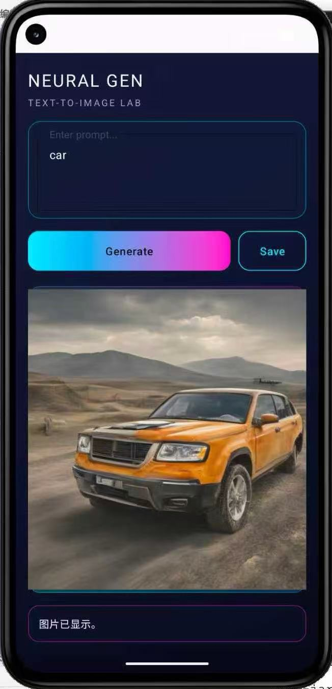
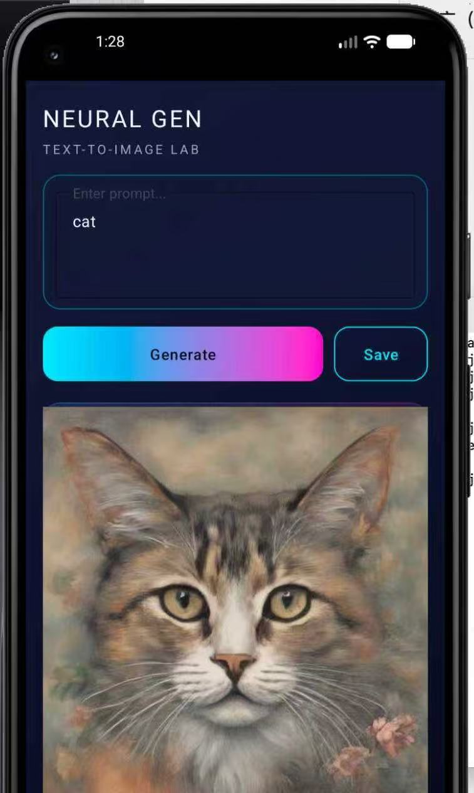

# AI Image Generator — Android App & Security Hardening

A Kotlin Android app that turns text prompts into images through a remote AI API, with image previews and gallery saving. The project combines **Android development, API integration, layered application architecture, and security hardening**.

## App preview

<table>
  <tr>
    <td align="center" valign="top">
      
      <br><strong>Vehicle image generation</strong>
    </td>
    <td align="center" valign="top">
      
      <br><strong>Animal image generation</strong>
    </td>
  </tr>
</table>

*Development screenshots showing prompt input and generated image previews.*

## Features

- **Text-to-image generation:** authenticate with the API and submit a prompt to request an image.
- **Responsive UI state:** prompt validation, loading feedback, cancellation, and error messages.
- **Preview and save:** display images with Coil and export JPEGs to the device gallery through MediaStore.
- **API session handling:** bootstrap authentication, optional session upgrade, and refresh handling when supported by the service.
- **Release hardening:** obfuscation, encrypted credential fragments, certificate pinning, and runtime integrity checks.

## Tech stack

| Area | Technologies |
| --- | --- |
| Android UI | Kotlin, XML layouts, ViewBinding, Material Components |
| State and concurrency | ViewModel, StateFlow, Kotlin coroutines |
| API integration | Retrofit, OkHttp, Gson |
| Image handling | Coil, Android MediaStore |
| Security | R8/ProGuard, StringFog, AES-GCM, EncryptedSharedPreferences, Android Keystore |

## Architecture and API integration

```text
Activity + ViewBinding -> ViewModel + StateFlow -> Use case -> Repository
                                                               |
                                                        Retrofit / OkHttp
                                                               |
                                                            AI API

Image URL -> Validation -> Coil preview / MediaStore gallery save
```

**Separation of responsibilities.** The Activity binds the interface, the ViewModel manages screen state and cancellation, and the use case and repository coordinate generation and API access. Coroutines handle asynchronous work, while StateFlow exposes loading, success, and error states to the UI.

**A complete API workflow.** The client calls `/auth` to obtain a signature, then submits that signature and the prompt to `/generate_image`. Returned image paths are normalized and validated before display or saving. Authentication, generation, and image-loading failures receive distinct user-facing feedback.

**Session handling with a fallback.** When no access value is cached, the app attempts a session upgrade using its bootstrap credential. If the service does not support that flow, it can fall back to the bootstrap Authorization value. When a refresh token is available, a 401 can trigger refresh and one request replay.

**Consistent image networking.** Authenticated API calls, Coil previews, and gallery downloads share an OkHttp client. Session creation and refresh use a separate client with the same network policy, without the Authorization interceptor or refresh authenticator.

## Security hardening

| Area | Implementation |
| --- | --- |
| Release obfuscation | R8/ProGuard and resource shrinking, with StringFog applied to application-package strings. |
| Credential reconstruction | Build-time AES-GCM encryption splits bootstrap material into four generated fragments. Key derivation incorporates the package name, signing-certificate fingerprint, version code, and salts; decoy pipelines add static-analysis noise. |
| Network protection | HTTPS, release certificate pinning, host allowlisting, and image URL/content-type validation. |
| Local storage and logging | Keystore-backed encrypted preferences, disabled application backup, redacted credential-bearing DTOs, and debug-only OkHttp logging. |
| Runtime integrity | Signing verification and debugger/hooking checks guard sensitive operations. High-risk environments or a signing mismatch block requests; medium-risk indicators produce a warning. |

These measures raise reverse-engineering effort rather than make client-side credentials impossible to recover. The app still needs plaintext credential material at runtime.

## Engineering decisions

- **Preserve correctness while obfuscating.** Explicit Gson model and TypeToken keep rules retain the types needed for release response parsing. The design balances shrinking and obfuscation with reliable serialization.
- **Protect the whole image workflow.** Gallery saving uses the same configured network client as image preview and authenticated API calls, rather than introducing a separate download path without those controls.
- **Separate development from release behavior.** Debug builds allow local proxy debugging and skip release integrity enforcement. Release builds use certificate pins, signing checks, and generated encrypted bootstrap material.
- **Use reverse-engineering findings to refine the design.** Credential handling goes beyond simple string obfuscation, while retaining the distinction between making analysis harder and keeping a reusable secret out of a client entirely.

## Environment

Kotlin **1.9.24**, JVM target **17**, Android minimum **API 24**, and compile/target **API 34**. Image generation uses an external course AI service and requires valid credentials; the image-generation model and backend are not part of this repository.
